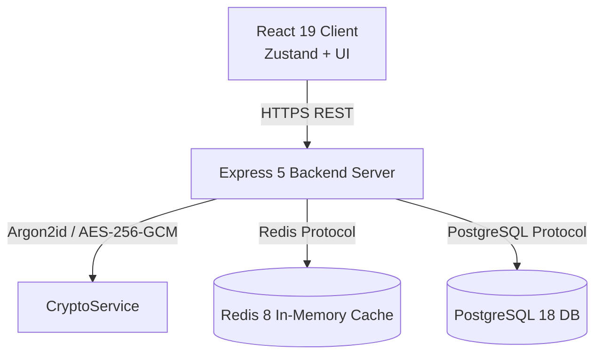
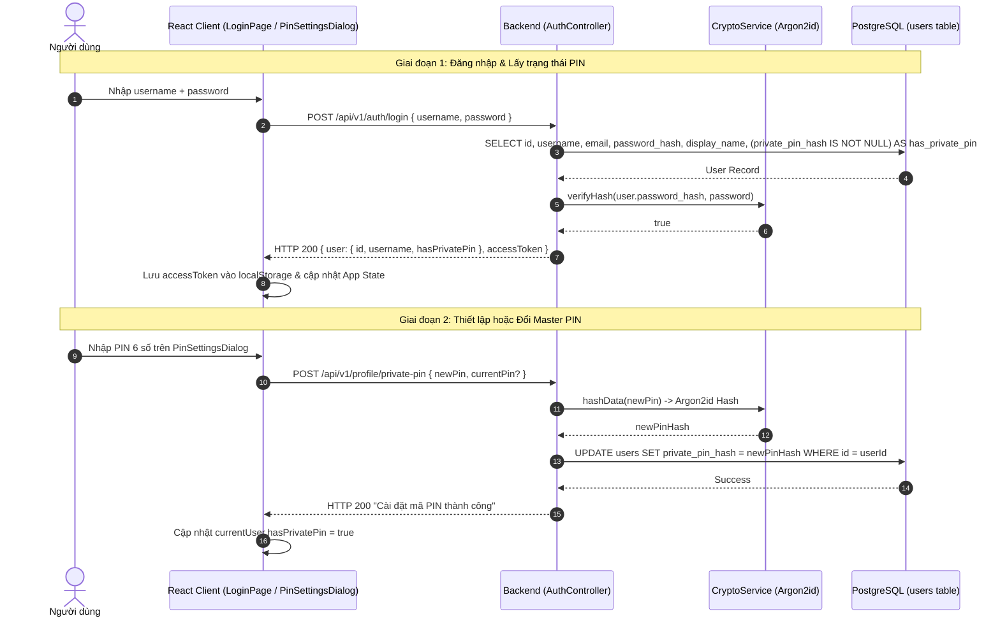

# Thiết kế Luồng Xác thực Phiên & Cài đặt Master PIN

## 1. Overview & Context

Tài liệu thiết kế quy trình xác thực người dùng, cấp phát phiên làm việc JWT và thiết lập/đổi mã **Master PIN** bí mật để bảo vệ các ghi chú riêng tư.

### Mục tiêu (Goals)

- Đảm bảo an toàn mật khẩu người dùng với thuật toán băm bộ nhớ cứng `Argon2id`.
- Thiết lập và quản lý vòng đời Master PIN để dẫn xuất khóa bọc (KEK) phục vụ mã hóa phong bì (Enveloped Encryption).
- Đồng bộ cờ `hasPrivatePin` giữa PostgreSQL, Express API và React Client state.

### Ngoài phạm vi (Non-Goals)

- Tự động khôi phục mã PIN khi quên (Zero-Knowledge: mất Master PIN đồng nghĩa với việc không thể giải mã các ghi chú đã khóa).

---

## 2. Architecture

---

## 3. Operational Flow

---

## 4. Security & Reliability

1. **Chống tấn công Brute-force**:
   - Áp dụng Redis sliding-window rate limiting trên các endpoint xác thực (`/api/v1/auth/login`: tối đa 5 requests/phút).
   - Cơ chế **Fail-Open**: Nếu Redis gặp sự cố, hệ thống cho phép request đi tiếp và log warning để bảo đảm tính sẵn sàng.
2. **Ký tự hợp lệ**:
   - Schema Zod `setPrivatePinSchema` chặn đứng mọi chuỗi không đúng biểu thức chính quy `/^\d{6}$/`.
3. **Không lưu trữ mã PIN thô**:
   - Tuyệt đối không lưu plaintext PIN trong Database hay Redis. Server chỉ lưu chuỗi băm Argon2id tại `users.private_pin_hash`.

---

## 5. Domain Invariant Taxonomy

| Invariant ID    | Mô tả bất biến                              | Cơ chế bảo đảm                              | Kiểm thử xác minh                       |
| :-------------- | :------------------------------------------ | :------------------------------------------ | :-------------------------------------- |
| **INV-AUTH-01** | Mật khẩu và PIN luôn được băm bằng Argon2id | `CryptoService.hashData`                    | `tests/services/crypto.service.test.ts` |
| **INV-AUTH-02** | Master PIN bắt buộc đúng 6 chữ số           | Zod `setPrivatePinSchema` regex `/^\d{6}$/` | `schemas/auth.schema.ts`                |
| **INV-AUTH-03** | Đổi PIN yêu cầu xác thực currentPin         | `AuthController.setPrivatePin` FOR UPDATE   | `controllers/auth.controller.ts`        |
