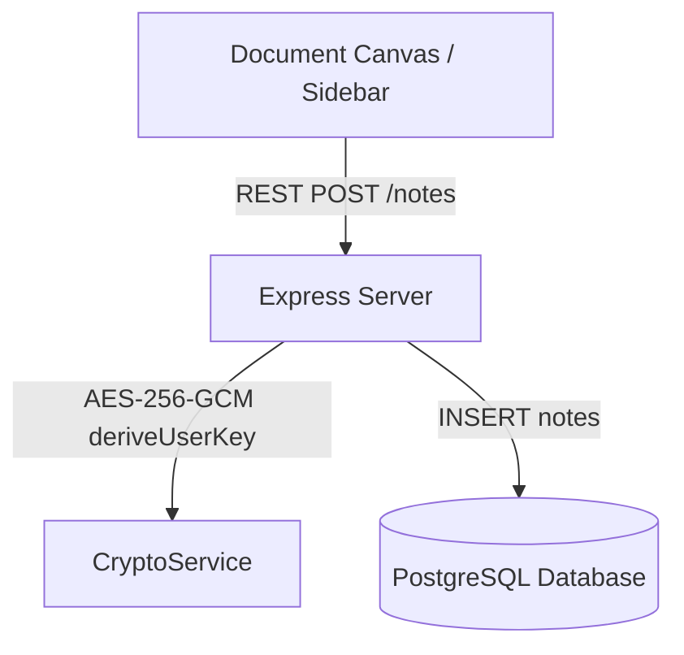
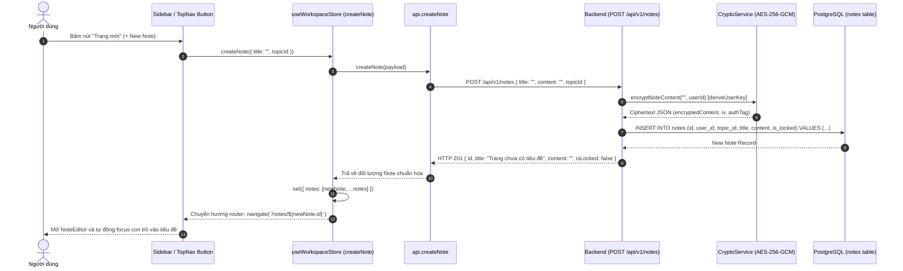

# Thiết kế Luồng Tạo Ghi Chú & Mã Hóa Mặc Định

## 1. Overview & Context

Tài liệu thiết kế quy trình tạo mới ghi chú trên giao diện NoteVault với cơ chế mã hóa mặc định khi lưu trữ (Default Encryption at Rest) bằng thuật toán AES-256-GCM.

### Mục tiêu (Goals)

- Đảm bảo 100% nội dung ghi chú lưu vào PostgreSQL ở dạng ciphertext, không lưu trữ plaintext.
- Tự động gán ghi chú vào chủ đề (`topicId`) nếu đang đứng tại trang chủ đề tương ứng.
- Phản hồi nhanh với Optimistic UI trên React client để người dùng có thể gõ ngay lập tức.

### Ngoài phạm vi (Non-Goals)

- Tự động gắn khóa bảo vệ ngay khi tạo (ghi chú tạo mới mặc định `isLocked: false`).

---

## 2. Architecture

---

## 3. Operational Flow

---

## 4. Security & Reliability

1. **Khóa mã hóa dẫn xuất (Key Derivation)**:
   - Sử dụng `deriveUserKey(userId)` qua hàm băm `scryptSync` kết hợp secret `PRIVATE_NOTE_MASTER_KEY` để tạo khóa 32 bytes AES-256 đối xứng.
2. **Không tái sử dụng IV**:
   - Mỗi lần mã hóa một bản ghi, `crypto.randomBytes(16)` được gọi để sinh IV ngẫu nhiên duy nhất, loại bỏ hoàn toàn nguy cơ phân tích ciphertext khi sửa đổi lặp lại.
3. **Optimistic Rollback**:
   - Nếu API trả lỗi (mất mạng, server timeout), Zustand store tự động rollback danh sách ghi chú về trạng thái trước đó và hiển thị thông báo lỗi.

---

## 5. Domain Invariant Taxonomy

| Invariant ID    | Mô tả bất biến                                              | Cơ chế bảo đảm                     | Kiểm thử xác minh                       |
| :-------------- | :---------------------------------------------------------- | :--------------------------------- | :-------------------------------------- |
| **INV-NOTE-01** | Content lưu trữ trong DB luôn là payload AES-256-GCM hợp lệ | `CryptoService.encryptNoteContent` | `tests/services/crypto.service.test.ts` |
| **INV-NOTE-02** | Tiêu đề rỗng tự động fallback "Trang chưa có tiêu đề"       | Backend Note Controller default    | `controllers/note.controller.ts`        |
| **INV-NOTE-03** | Ghi chú luôn thuộc về đúng `userId` của JWT session         | `requireUserId` token verification | `utils/auth.util.ts`                    |
