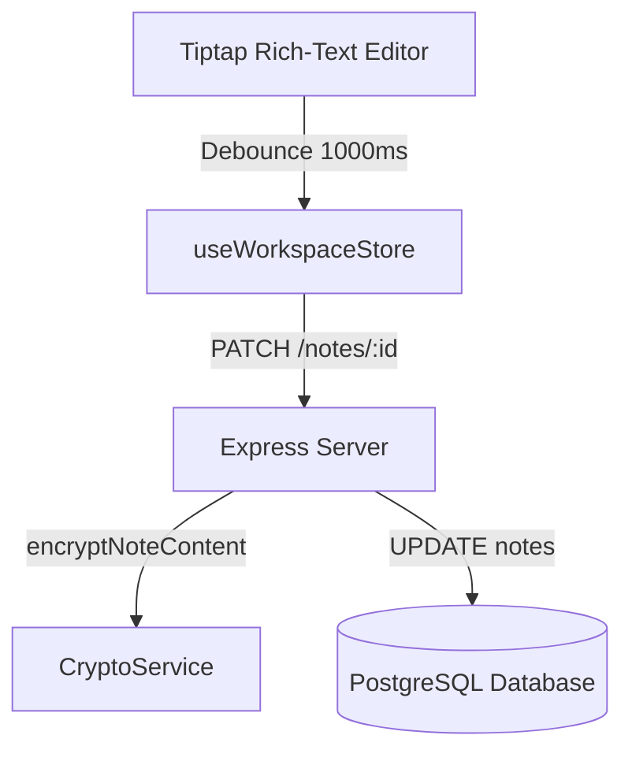
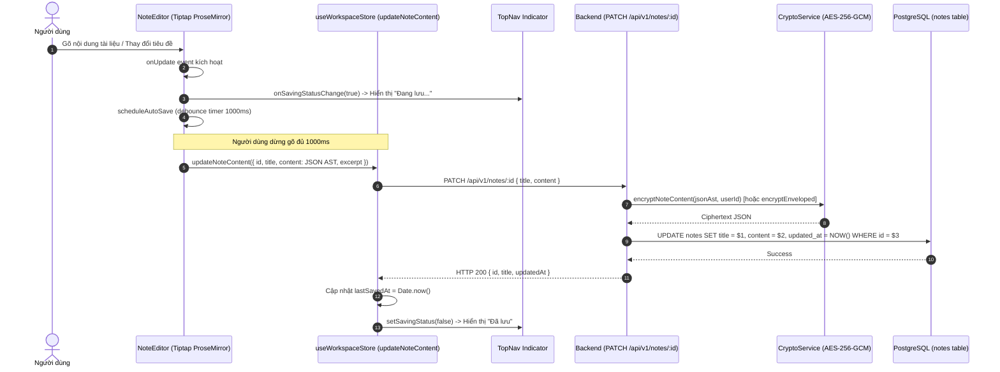

# Thiết kế Luồng Tự Động Lưu Trình Soạn Thảo & JSON AST

## 1. Overview & Context

Tài liệu thiết kế quy trình tự động lưu nội dung văn bản từ trình soạn thảo rich-text Tiptap về backend dưới dạng cây cú pháp ProseMirror JSON AST, được mã hóa liên tục mà không gián đoạn thao tác gõ của người dùng.

### Mục tiêu (Goals)

- Tự động debounce lưu dữ liệu sau 1000ms người dùng ngừng gõ phím.
- Hiển thị trực quan trạng thái lưu trên TopNav ("Đang lưu..." $\rightarrow$ "Đã lưu").
- Chuyển đổi định dạng văn bản thành ProseMirror JSON AST object thay vì lưu chuỗi HTML thô.

### Ngoài phạm vi (Non-Goals)

- Hợp nhất xung đột thời gian thực (CRDT) nhiều người cùng sửa một lúc (NoteVault hướng đến sử dụng cá nhân).

---

## 2. Architecture

---

## 3. Operational Flow

---

## 4. Security & Reliability

1. **Khử trùng dữ liệu đầu vào (Input Sanitization)**:
   - Dữ liệu trước khi mã hóa được Tiptap schema kiểm duyệt thành cây node JSON AST, ngăn chặn hoàn toàn việc chèn thẻ script hoặc iframe độc hại.
2. **Debounce hủy hẹn giờ (Timer Teardown)**:
   - Khi người dùng chuyển trang hoặc đóng tab, timer debounce cũ được `clearTimeout()` để tránh rò rỉ bộ nhớ hoặc gửi request đè dữ liệu sai ghi chú.

---

## 5. Domain Invariant Taxonomy

| Invariant ID    | Mô tả bất biến                                               | Cơ chế bảo đảm                     | Kiểm thử xác minh                  |
| :-------------- | :----------------------------------------------------------- | :--------------------------------- | :--------------------------------- |
| **INV-SAVE-01** | Trạng thái lưu luôn phản hồi chính xác trên thanh trạng thái | `setSavingStatus` Zustand hook     | `stores/useWorkspaceStore.ts`      |
| **INV-SAVE-02** | Payload nội dung luôn có thể parse ngược lại thành JSON AST  | `JSON.stringify(editor.getJSON())` | `components/editor/NoteEditor.tsx` |
| **INV-SAVE-03** | Debounce delay cố định 1000ms tránh spam API                 | `scheduleAutoSave` useRef timeout  | `components/editor/NoteEditor.tsx` |
