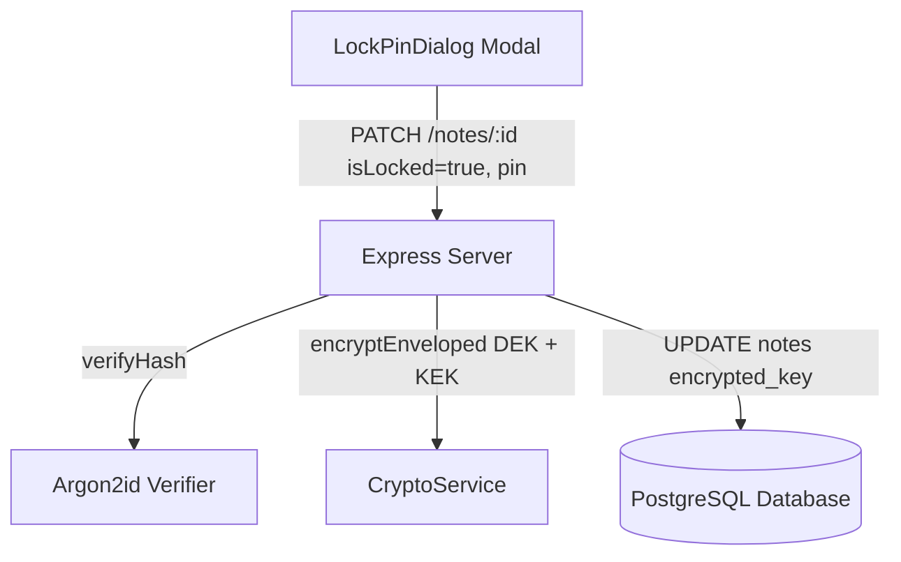
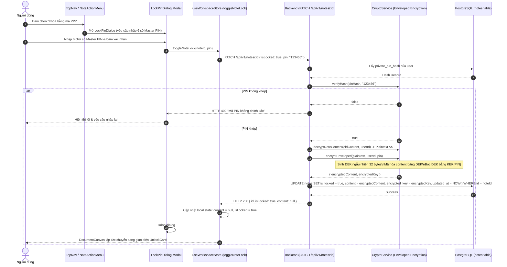

# Thiết kế Luồng Khóa Ghi Chú & Mã Hóa Phong Bì

## 1. Overview & Context

Tài liệu thiết kế quy trình nâng cấp một ghi chú thông thường thành ghi chú bảo vệ bằng Master PIN thông qua cơ chế **Mã hóa phong bì (Enveloped Encryption)**.

### Mục tiêu (Goals)

- Bắt buộc xác thực Master PIN hiện tại của người dùng trước khi tiến hành khóa ghi chú.
- Sinh khóa DEK ngẫu nhiên 32 bytes độc lập mã hóa nội dung, sau đó dùng KEK dẫn xuất từ PIN để bọc lại DEK và lưu vào cột `encrypted_key`.
- Khi đã khóa thành công, ngay lập tức che phủ (`mask: null`) nội dung hiển thị trên UI.

### Ngoài phạm vi (Non-Goals)

- Cho phép đặt mỗi ghi chú một mã PIN khác nhau (toàn bộ hệ thống quy chuẩn theo một Master PIN chung).

---

## 2. Architecture

---

## 3. Operational Flow

---

## 4. Security & Reliability

1. **Kiểm tra quyền sở hữu và xác thực PIN kép**:
   - Backend chỉ cho phép bật cờ `isLocked: true` khi có trường `pin` hợp lệ khớp với `private_pin_hash`.
2. **Không làm rò rỉ nội dung sau khi khóa**:
   - Phản hồi từ server và state trong Zustand store đều chuyển trường `content` thành `null`.

---

## 5. Domain Invariant Taxonomy

| Invariant ID    | Mô tả bất biến                                               | Cơ chế bảo đảm                               | Kiểm thử xác minh                       |
| :-------------- | :----------------------------------------------------------- | :------------------------------------------- | :-------------------------------------- |
| **INV-LOCK-01** | Bật `isLocked: true` bắt buộc phải kèm theo mã PIN chính xác | `NoteController.updateNote` pin verification | `controllers/note.controller.ts`        |
| **INV-LOCK-02** | Ghi chú bị khóa luôn có `encrypted_key` hợp lệ               | `CryptoService.encryptEnveloped`             | `tests/services/crypto.service.test.ts` |
| **INV-LOCK-03** | Khóa ghi chú lập tức che giấu nội dung (`content: null`)     | Response formatting logic                    | `controllers/note.controller.ts`        |
