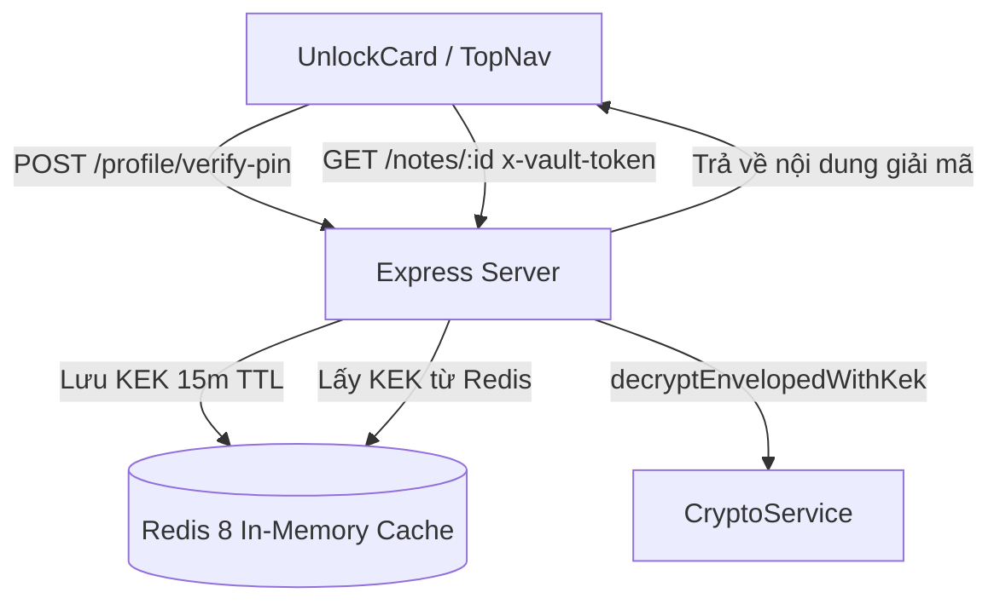
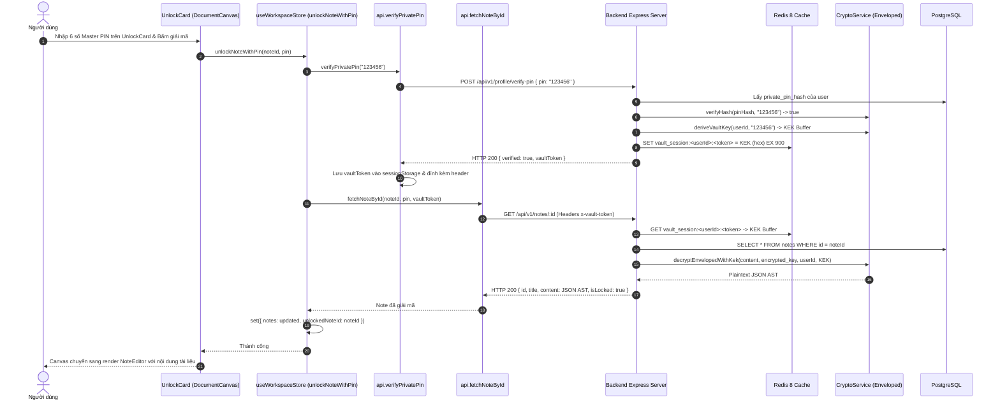

# Thiết kế Luồng Mở Khóa Ghi Chú & Phiên Vault Redis

## 1. Overview & Context

Tài liệu thiết kế quy trình mở khóa ghi chú bảo mật bằng Master PIN, cấp phát phiên làm việc Vault tạm thời trên Redis (15m TTL) và giải mã nội dung Enveloped Encryption.

### Mục tiêu (Goals)

- Nhập PIN 1 lần để mở phiên làm việc Vault (`vaultToken`) có thời hạn 15 phút lưu trên Redis.
- Các request đọc ghi chú tiếp theo sử dụng `x-vault-token` để lấy KEK từ Redis (~0.5ms), tránh băm lại Argon2id/scryptSync.
- Cho phép người dùng chủ động bấm "Khóa phiên Vault" để thu hồi quyền truy cập tức thì bằng lệnh `UNLINK`.

### Ngoài phạm vi (Non-Goals)

- Lưu trữ KEK vĩnh viễn trên client hoặc server (sau 15 phút idle, phiên tự động hết hạn).

---

## 2. Architecture

---

## 3. Operational Flow

---

## 4. Security & Reliability

1. **Thu hồi phiên làm việc tức thì (Instant Session Revocation)**:
   - Khi người dùng bấm "Khóa phiên Vault", endpoint `POST /api/v1/profile/lock-vault` gọi lệnh `redisClient.unlink(sessionKey)` để xóa ngay lập tức KEK khỏi bộ nhớ, hủy toàn bộ quyền xem note khóa trên mọi tab.
2. **Cơ chế dự phòng Fail-Open**:
   - Nếu Redis tạm thời offline, client fallback gửi PIN qua header `x-private-pin`. Backend sẽ xác thực qua PostgreSQL và giải mã trực tiếp, đảm bảo hệ thống không bị ngừng trệ hoàn toàn.
3. **Bảo mật lưu trữ Client**:
   - `vaultToken` chỉ được lưu trong `sessionStorage`, tự động hủy hoàn toàn khi người dùng đóng trình duyệt.

---

## 5. Domain Invariant Taxonomy

| Invariant ID     | Mô tả bất biến                                                         | Cơ chế bảo đảm                             | Kiểm thử xác minh                              |
| :--------------- | :--------------------------------------------------------------------- | :----------------------------------------- | :--------------------------------------------- |
| **INV-VAULT-01** | Phiên Vault token trên Redis có TTL tối đa 900 giây (15 phút)          | `VaultSessionService.createSession` EX 900 | `tests/services/vault-session.service.test.ts` |
| **INV-VAULT-02** | Khóa phiên Vault xóa session key bằng lệnh UNLINK bất đồng bộ          | `VaultSessionService.revokeSession`        | `tests/services/vault-session.service.test.ts` |
| **INV-VAULT-03** | Giải mã với KEK sai hoặc thiếu credentials luôn trả về `content: null` | `formatNoteResponse` masking               | `controllers/note.controller.ts`               |
