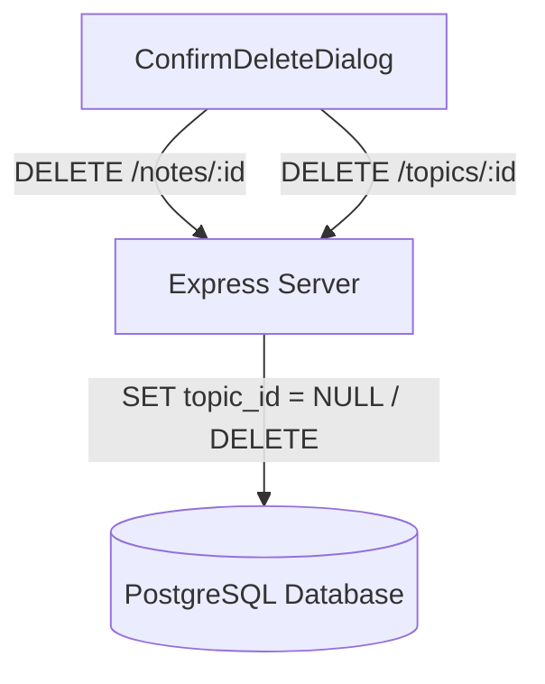
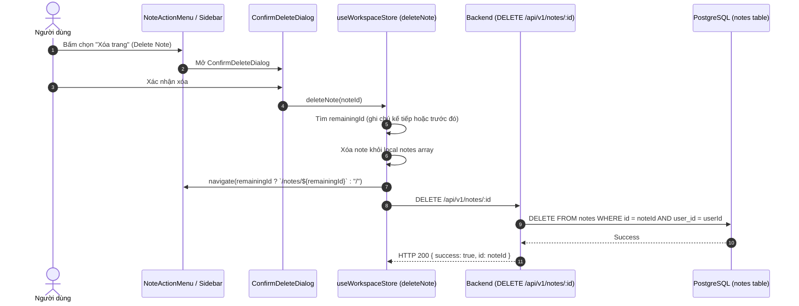

# Thiết kế Luồng Xóa Ghi Chú / Chủ Đề & Đồng Bộ Trạng Thái

## 1. Overview & Context

Tài liệu thiết kế quy trình xóa ghi chú và xóa chủ đề (Topic), xử lý hành vi phân rã (cascade / unclassified) và đồng bộ trạng thái điều hướng UI mượt mà.

### Mục tiêu (Goals)

- Xóa ghi chú độc lập và tự động điều hướng sang ghi chú liền kề nếu đang mở ghi chú đó.
- Xóa chủ đề: Các ghi chú bên trong được chuyển về trạng thái Chưa phân loại (`topic_id = NULL`), không làm mất ghi chú của người dùng.
- Cập nhật Optimistic UI ngay lập tức trên Sidebar và Workspace Document Canvas.

### Ngoài phạm vi (Non-Goals)

- Xóa vĩnh viễn ghi chú khi xóa chủ đề (toàn bộ ghi chú được bảo toàn).

---

## 2. Architecture

---

## 3. Operational Flow

---

## 4. Security & Reliability

1. **Bảo vệ quyền sở hữu dữ liệu (Tenant Isolation)**:
   - Các truy vấn DELETE luôn kèm mệnh đề `WHERE id = $1 AND user_id = $2`, ngăn chặn việc xóa nhầm hoặc xóa trộm dữ liệu của người dùng khác.
2. **Không làm rỗng màn hình**:
   - Khi xóa ghi chú đang mở, thuật toán `deleteNote` tự động tính toán ghi chú lân cận trong danh sách để điều hướng người dùng tới, tránh lỗi màn hình trắng.

---

## 5. Domain Invariant Taxonomy

| Invariant ID   | Mô tả bất biến                                                   | Cơ chế bảo đảm                          | Kiểm thử xác minh                |
| :------------- | :--------------------------------------------------------------- | :-------------------------------------- | :------------------------------- |
| **INV-DEL-01** | Chỉ chủ sở hữu mới có quyền xóa ghi chú hoặc chủ đề              | SQL query ràng buộc `user_id = $2`      | `controllers/note.controller.ts` |
| **INV-DEL-02** | Xóa chủ đề không xóa ghi chú (ghi chú chuyển thành unclassified) | Database Foreign Key ON DELETE SET NULL | `prisma/schema.prisma`           |
| **INV-DEL-03** | Trạng thái URL luôn đồng bộ với ghi chú còn lại sau khi xóa      | Zustand `deleteNote` navigation logic   | `stores/useWorkspaceStore.ts`    |
