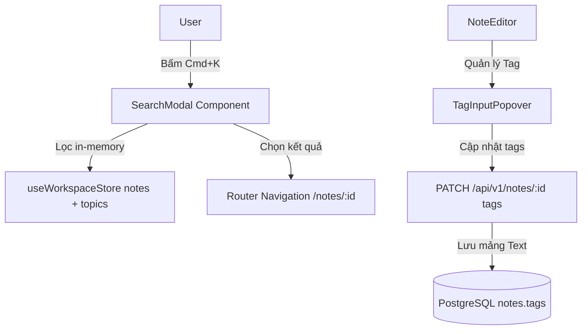
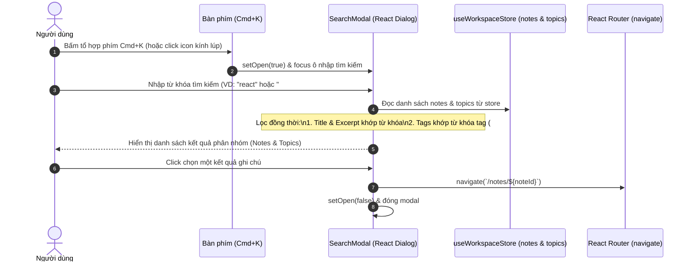

# Thiết kế Hệ thống Tìm kiếm Toàn cục & Quản lý Thẻ (Tag)

## 1. Overview & Context

Tài liệu thiết kế cơ chế tìm kiếm toàn cục (`Cmd+K` / `Ctrl+K`) và hệ thống phân loại theo Thẻ (Tags) trong NoteVault.

### Mục tiêu (Goals)

- Cho phép tìm kiếm tức thì theo tiêu đề, đoạn trích tóm tắt (excerpt) và thẻ tag.
- Phù hợp với kiến trúc Zero-Knowledge: Tìm kiếm nội dung văn bản thực hiện an toàn trên bộ nhớ RAM của client thay vì lưu chỉ mục văn bản thô trên cơ sở dữ liệu.
- Quản lý thẻ ghi chú chặt chẽ (tối đa 8 thẻ/ghi chú, chuẩn hóa chữ thường và tiền tố `#`).

### Ngoài phạm vi (Non-Goals)

- Tìm kiếm ngữ nghĩa bằng AI hoặc vector embeddings lưu trữ trên server.

---

## 2. Architecture

---

## 3. Operational Flow

---

## 4. Security & Reliability

1. **Bảo mật tìm kiếm Zero-Knowledge**:
   - PostgreSQL chỉ lưu trữ ciphertext trong cột `content`. Việc tìm kiếm nội dung giải mã chỉ diễn ra trên client sau khi người dùng mở khóa phiên.
   - Cột `tags` (mảng text) lưu trữ nhãn phân loại công khai mà không làm lộ nội dung chi tiết bên trong tài liệu.
2. **Giới hạn số lượng thẻ**:
   - `TagInputPopover` và schema API giới hạn cứng tối đa 8 tags trên mỗi ghi chú nhằm bảo đảm hiệu năng hiển thị và tránh phân mảnh dữ liệu.

---

## 5. Domain Invariant Taxonomy

| Invariant ID    | Mô tả bất biến                                          | Cơ chế bảo đảm                         | Kiểm thử xác minh                       |
| :-------------- | :------------------------------------------------------ | :------------------------------------- | :-------------------------------------- |
| **INV-TAG-01**  | Mỗi ghi chú có tối đa 8 thẻ tag                         | `TagInputPopover` maxTags & Zod schema | `components/editor/TagInputPopover.tsx` |
| **INV-TAG-02**  | Thẻ tag luôn được chuẩn hóa chữ thường không dấu cách   | Hàm `normalizeTag`                     | `components/editor/NoteEditor.tsx`      |
| **INV-SRCH-01** | Tìm kiếm theo `#tag` lọc chính xác qua mảng `note.tags` | `SearchModal` filteredNotes useMemo    | `components/dashboard/SearchModal.tsx`  |
