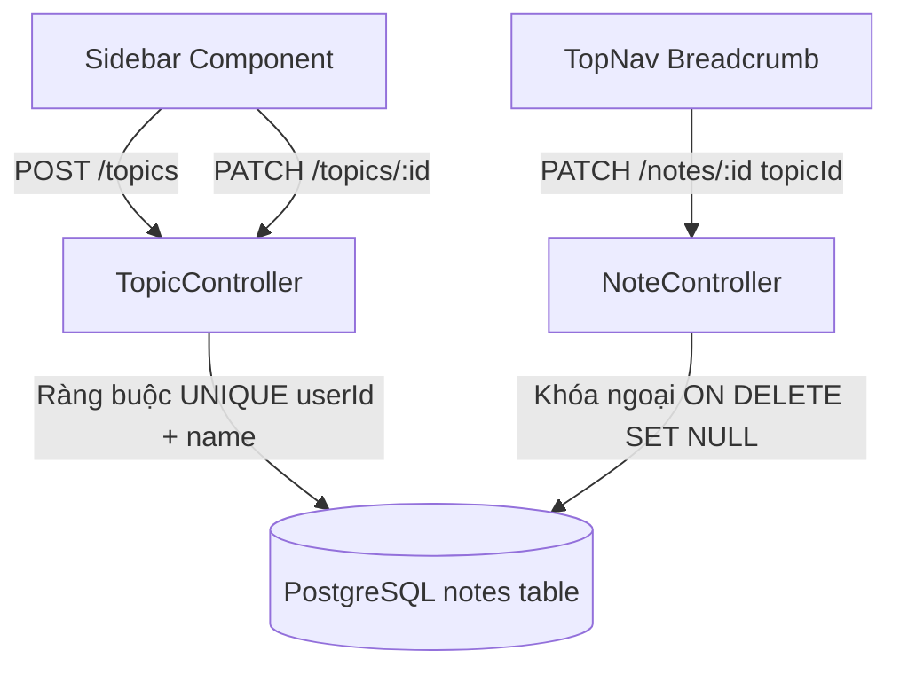
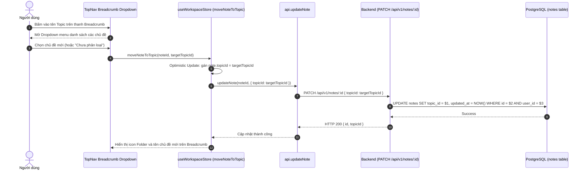

# Thiết kế Hệ thống Phân loại Chủ đề & Cấu trúc Thư mục

## 1. Overview & Context

Tài liệu thiết kế cấu trúc phân cấp Chủ đề (Topics) và cơ chế gom nhóm ghi chú trong NoteVault.

### Mục tiêu (Goals)

- Cho phép người dùng tổ chức ghi chú theo từng chủ đề công việc riêng biệt.
- Hỗ trợ đổi tên chủ đề và tự động cập nhật tên trên toàn bộ Breadcrumb thanh điều hướng.
- Cho phép di chuyển nhanh ghi chú giữa các chủ đề ngay từ menu breadcrumb trên TopNav hoặc submenu trong Sidebar.
- Bảo vệ dữ liệu khi xóa chủ đề: Ghi chú con không bị xóa mà tự động chuyển sang trạng thái "Chưa phân loại" (`topic_id = NULL`).

### Ngoài phạm vi (Non-Goals)

- Cấu trúc thư mục con lồng nhau vô hạn cấp (NoteVault duy trì cấu trúc 1 cấp phẳng Topic $\rightarrow$ Notes để tối ưu trải nghiệm nhanh).

---

## 2. Architecture

---

## 3. Operational Flow

---

## 4. Security & Reliability

1. **Ràng buộc duy nhất theo người dùng**:
   - PostgreSQL enforce ràng buộc `@@unique([userId, name])` trên bảng `topics`. Người dùng không thể tạo 2 chủ đề trùng tên, nhưng 2 người dùng khác nhau hoàn toàn có thể đặt cùng tên chủ đề.
2. **Cô lập dữ liệu người dùng (Tenant Isolation)**:
   - Toàn bộ các thao tác tạo, đọc, sửa, xóa chủ đề đều có mệnh đề bắt buộc `WHERE user_id = $1` lấy từ JWT payload đã xác thực.

---

## 5. Domain Invariant Taxonomy

| Invariant ID     | Mô tả bất biến                                      | Cơ chế bảo đảm                              | Kiểm thử xác minh             |
| :--------------- | :-------------------------------------------------- | :------------------------------------------ | :---------------------------- |
| **INV-TOPIC-01** | Tên chủ đề là duy nhất trong phạm vi mỗi người dùng | `@@unique([userId, name])` constraint       | `prisma/contract.prisma`      |
| **INV-TOPIC-02** | Xóa chủ đề không xóa ghi chú con                    | Foreign key `ON DELETE SET NULL`            | `prisma/contract.prisma`      |
| **INV-TOPIC-03** | Di chuyển ghi chú cập nhật breadcrumb tức thì       | Optimistic update trong `useWorkspaceStore` | `stores/useWorkspaceStore.ts` |
